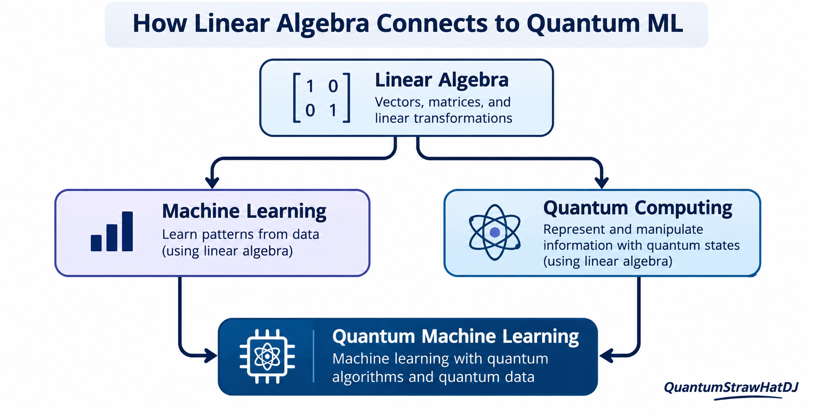

# Why Linear Algebra for Quantum Machine Learning?

## My Goal

My goal is to become a Quantum Machine Learning Engineer.

I am learning Linear Algebra because it provides
the mathematical foundation for Machine Learning
and Quantum Computing.

This repository documents my understanding,
reasoning, Python practice, and progress.

#QuantumStrawHatDJ

## How Linear Algebra Connects to Quantum ML

## Why Is Linear Algebra Necessary?

Linear Algebra helps us represent and transform information using vectors and matrices.

In Machine Learning, vectors represent data and matrices help perform calculations.

In Quantum Computing, vectors represent quantum states and matrices represent quantum gates.

Therefore, understanding Linear Algebra is an important foundation for learning Quantum Machine Learning.

## Understanding the Reasoning
Think of these two connections:
- **Machine Learning:** Numbers → Vectors → Calculations → Predictions
- **Quantum Computing:** Quantum States → Vectors → Quantum Gates → New Quantum States

Both rely on Linear Algebra.
